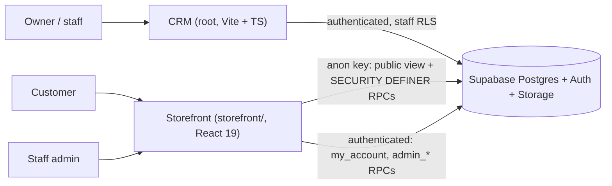

# Attrangii

Software for **Attrangii**, a small shop that resells toys and collectibles (prices in INR). One repository, two apps, one shared Supabase project:

| App | Location | Audience | Description |
|---|---|---|---|
| **CRM** | repo root (`src/main.tsx`) | Owner / staff | Inventory, invoices, payment tracking, reports, PDF export |
| **Storefront** | `storefront/` | Public customers + staff admin | Online shop, cart, coupons, checkout, accounts, order tracking, order admin |

Both apps read and write the same tables, so an order placed on the storefront shows up as an invoice in the CRM.

## Contents

- [Features](#features) - [Architecture](#architecture) - [Repository structure](#repository-structure) - [Tech stack](#tech-stack)
- [Getting started](#getting-started) - [Database setup](#database-setup) - [Running the apps](#running-the-apps)
- [Deployment (Vercel)](#deployment-vercel) - [Security notes](#security-notes) - [Known limitations](#known-limitations) - [More docs](#more-docs)

## Features

### CRM (repo root)

- **Dashboard**: month-to-date sales, monthly revenue chart from real billing data, top sellers, low-stock alerts, time-of-day greeting.
- **Inventory**: add / edit products with SKU, category, buying and selling price and stock level. Product images: upload, gallery, replace, make main, delete. Thumbnails are fixed-size in lists.
- **Invoices**: create (searchable product picker, tax, discount), edit, delete. Stock is deducted on create, restored on edit/delete, and validated so an invoice is never blocked by its own allocation.
- **Payment tracking**: record which team member (Mehul, Simarpreet, Dalbir) received each payment.
- **Reports**: category split of stock value, collections per team member, paid vs. pending outstanding. Filters by date preset, custom range and team member.
- **PDF export**: professional tax invoice generated in the browser (html2pdf.js).
- Responsive layout, works on phones.

### Storefront (`storefront/`)

- **Shop**: catalogue with search/filter; **one product per design** (e.g. individual Bricks, Naruto, Demon Slayer designs), each with an **image gallery**. Category "Pins" is not sold online.
- **Cart and checkout**: cart drawer, guest checkout or logged-in checkout.
- **Coupon codes**: percent or flat; minimum order, start/expiry dates, max total uses, one use per customer.
- **Shipping rule**: **Rs 80**, **free when items minus coupon is Rs 1500 or more**. Quoted server-side so the browser cannot change it.
- **Customer accounts**: sign up / log in, order history, order timeline (Order placed, Packed, Shipped, Out for delivery, Delivered; also Returned / Cancelled).
- **Order tracking** without an account: invoice number plus the phone used at checkout.
- **Admin** (staff only, `/admin`): orders list, shipping status, courier and tracking number/URL, payment status and method/reference, cancel order (`/admin`), and coupon management (`/admin/coupons`).

Storefront routes: `/`, `/shop`, `/product/:id`, `/checkout`, `/order/:invoice`, `/track`, `/login`, `/account`, `/admin/login`, `/admin`, `/admin/coupons`.

## Architecture



The CRM talks to tables directly as an authenticated staff user. The storefront never reads private tables: the public sees a safe view (`storefront_products`) and calls `SECURITY DEFINER` functions (`quote_order`, `place_order`, `track_order`, `my_account`, `admin_*`). Details: [docs/ARCHITECTURE.md](docs/ARCHITECTURE.md).

## Repository structure

```
.
├── src/
│   ├── main.tsx              CRM app (views, state, routing)
│   ├── lib/supabase.ts       Supabase client
│   └── index.css             Tailwind + CRM styles
├── index.html, vite.config.ts, tsconfig.json, package.json
├── supabase_schema.sql       Base CRM schema (run first)
├── check-and-seed.ts         Optional CRM inventory seed script
├── INITIALIZE.md             Original CRM initialisation notes
├── .env.example
├── docs/                     ARCHITECTURE.md, DATABASE.md, DESIGN.md
└── storefront/
    ├── src/
    │   ├── App.tsx           Routes
    │   ├── pages/            Home, Shop, ProductPage, Checkout, OrderSuccess,
    │   │                     TrackOrder, Login, Account, admin/
    │   ├── components/       Layout, CartDrawer, Gallery, ProductCard, OrderTracking
    │   └── lib/              api.ts, auth.tsx, cart.tsx, supabase.ts, types.ts, ...
    ├── supabase/             storefront.sql, accounts-admin.sql,
    │                         shipping-coupons.sql, seed-products.sql
    ├── vercel.json           SPA rewrite
    └── package.json
```

## Tech stack

| Layer | CRM | Storefront |
|---|---|---|
| UI | Vanilla TypeScript, string-templated views | React 19 + TypeScript |
| Routing | In-app view router | react-router-dom 7 |
| Styling | Tailwind CSS 4 | Tailwind CSS 4 |
| Build | Vite 6 | Vite 6 (`tsc --noEmit` before build) |
| Extras | html2pdf.js (PDF), lucide-react, motion | lucide-react |
| Backend | Supabase (Postgres, Auth, Storage) | same project |

## Getting started

**Prerequisites:** Node.js 20+ (any current LTS), npm, and a Supabase project.

```bash
git clone https://github.com/M-Destiny/Attrangi.git
cd Attrangi
npm install                    # CRM
cd storefront && npm install   # storefront
```

**Environment variables** (names only; get values from Supabase > Project Settings > API):

| App | File | Variables |
|---|---|---|
| CRM | `.env` (repo root) | `VITE_SUPABASE_URL`, `VITE_SUPABASE_ANON_KEY` |
| Storefront | `storefront/.env` | `VITE_SUPABASE_URL`, `VITE_SUPABASE_ANON_KEY` |

Both must point at the **same** Supabase project. `.env*` files are git-ignored (except `.env.example`).

## Database setup

Run in the Supabase **SQL Editor**, in this order. Each storefront file is safe to re-run.

1. `supabase_schema.sql` - base CRM tables (`suppliers`, `products`, `customers`, `invoices`, `invoice_items`, `profiles`) and RLS.
2. `storefront/supabase/storefront.sql` - adds `products.images`, the public `storefront_products` view, and `track_order`.
3. `storefront/supabase/accounts-admin.sql` - profiles/roles, `is_staff()` / `is_admin()`, role-change guard, tightened staff-only RLS, `my_account`, admin order RPCs.
4. `storefront/supabase/shipping-coupons.sql` - shipping/payment columns on `invoices`, the `coupons` table, `quote_order`, `place_order`, and the admin shipping/coupon RPCs.
5. `storefront/supabase/seed-products.sql` - optional sample products (per-design Bricks, Naruto, Demon Slayer, etc.).

Also create a **public** Storage bucket named `product-images` (used by CRM uploads and storefront galleries).

**Before step 3:** run `select email, created_at from auth.users;`. Everyone already registered becomes **staff**; set any real shop customers back to `customer` afterwards.

### Roles

| Role | Who | Access |
|---|---|---|
| `customer` | Every new sign-up (default, enforced by trigger) | Own account and orders only, via RPCs |
| `staff` | Owner and team | CRM data, storefront admin pages |

Promote a user to staff (SQL Editor, as project owner):

```sql
update public.profiles set role = 'staff' where email = 'person@example.com';
```

Clients cannot change their own role (guard trigger). Further detail: [docs/DATABASE.md](docs/DATABASE.md).

## Running the apps

| App | Command | URL |
|---|---|---|
| CRM | `npm run dev` (repo root) | http://localhost:3000 |
| Storefront | `npm run dev` (in `storefront/`) | http://localhost:3100 |

Other scripts: `npm run build`, `npm run preview`, `npm run lint` (`tsc --noEmit`) in each app.

## Deployment (Vercel)

Create **two Vercel projects** from this one repository:

| Project | Root Directory | Build | Output |
|---|---|---|---|
| CRM | `./` | `npm run build` | `dist` |
| Storefront | `storefront` | `npm run build` | `dist` |

- Set `VITE_SUPABASE_URL` and `VITE_SUPABASE_ANON_KEY` in each project's Environment Variables.
- `storefront/vercel.json` rewrites every path to `/` so react-router deep links (`/shop`, `/track`, `/admin`) work on refresh.
- In Supabase > Authentication > URL Configuration, add both deployed URLs.

## Security notes

- **RLS is on.** Staff policies require `is_staff()`; customers can only see their own profile. Row access for the public goes through a column-limited view that hides buying price, supplier and serial number.
- **`SECURITY DEFINER` RPCs** (`quote_order`, `place_order`, `track_order`, `my_account`, `admin_*`) do the privileged work with a fixed `search_path`; internal helpers have execute revoked from clients. Prices, coupon discounts and shipping are computed in the database, not trusted from the browser.
- **The anon key is public by design** (it ships in the browser bundle). Protection comes from RLS and the RPCs, never from hiding the key. Never use or commit the `service_role` key.
- **Never commit `.env`.** Note that `.env.example` currently contains real-looking project values and a `GEMINI_API_KEY` placeholder; replace them with placeholders.
- Do not use default or shared passwords; create staff accounts with strong unique passwords. The old "Seed Initial Users" flow described in `INITIALIZE.md` predates this and should not be used in production.

## Known limitations

- No online payment gateway: payment (UPI, bank transfer, cash, card, other) is recorded manually by staff.
- No automated email/SMS notifications; customers check status in their account or on `/track`.
- The CRM is one large `src/main.tsx` with string-templated views and no automated tests.
- Stock is only deducted when an order is placed; there is no reservation for abandoned carts.
- Shipping rule (Rs 80 / Rs 1500) lives in the SQL function `_shipping_fee()`; changing it means editing SQL.
- `@google/genai` and `express` are listed in the CRM `package.json` but are not part of the documented features.

## More docs

- [docs/ARCHITECTURE.md](docs/ARCHITECTURE.md) - system design and data flow
- [docs/DATABASE.md](docs/DATABASE.md) - tables, functions, policies
- [docs/DESIGN.md](docs/DESIGN.md) - visual design system
- [storefront/README.md](storefront/README.md) - storefront-specific notes
- [INITIALIZE.md](INITIALIZE.md) - original CRM initialisation notes

## License

Proprietary, built specifically for Attrangii.
