# Attrangii Architecture

Audience: developers joining the project. Everything here is derived from the code in this repo (CRM at the repo root, storefront in `storefront/`, SQL in `storefront/supabase/`).

Two front-ends share **one Supabase project** (Postgres + Auth + Storage):

| App | Path | Stack | Users |
|---|---|---|---|
| CRM | repo root, `src/main.tsx` | Vanilla TypeScript + Vite, hand-rolled state/router/render, Tailwind v4, html2pdf.js | Staff (inventory, invoices, reports) |
| Storefront | `storefront/` | React 19 + TypeScript + Vite + Tailwind v4 + react-router-dom v7 | Public visitors, customers, staff (`/admin`) |

There is no custom backend server in production. All business logic that must be trusted lives in Postgres (RLS policies and `SECURITY DEFINER` functions).

---

## 1. System context

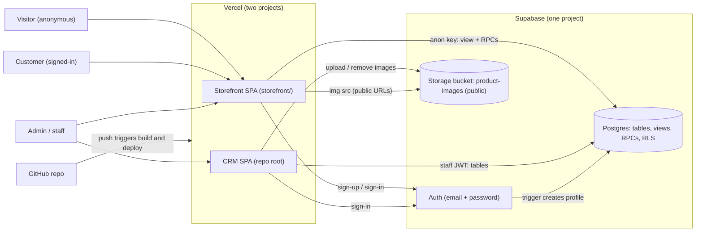

Both apps embed the **anon (publishable) key** at build time and talk to Supabase directly from the browser (PostgREST + `rpc`). Authorization is enforced by the database, not by the front-ends.

---

## 2. Storefront frontend architecture

Entry: `storefront/src/main.tsx` renders `BrowserRouter > AuthProvider > CartProvider > App`.

### Routing map (`App.tsx`)

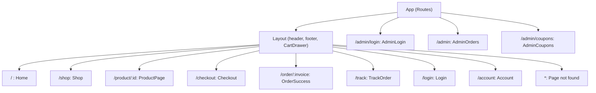

Admin routes are outside `Layout` (no storefront chrome). They guard themselves with `useAuth().isStaff`.

### Providers, lib layer, and dependency flow

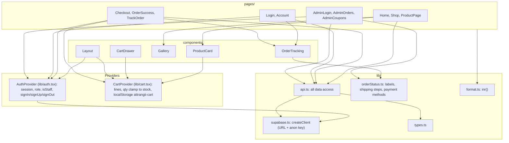

Key points:
- `lib/api.ts` is the **only** module (besides `auth.tsx`) that calls Supabase. Pages never call `supabase` directly.
- Catalog reads go to the `storefront_products` view (never the `products` table). `api.ts` also filters Pins client-side as defence in depth.
- Cart lives in `localStorage` (`attrangii-cart`), stores full `Product` snapshots, and clamps qty to the snapshot's `stock_level`. **Prices shown in the cart are indicative**; `quote_order`/`place_order` recompute everything server-side from the DB.
- `AuthProvider` fetches `profiles.role` for the session; `isStaff = role is set and role !== 'customer'`. This is a UX gate only; real enforcement is RLS and RPC checks.
- Data fetching is plain `useEffect` + promises (no query library).

### API surface used by the storefront (`lib/api.ts`)

| Function | Supabase call | Caller role |
|---|---|---|
| `getProducts`, `getProduct` | `select` on view `storefront_products` | anon / any |
| `quoteOrder` | rpc `quote_order` | anon / any |
| `placeOrder` | rpc `place_order` | anon / any |
| `trackOrder` | rpc `track_order` | anon / any |
| `getMyAccount` | rpc `my_account` | authenticated |
| `adminOrders` | rpc `admin_orders` | staff |
| `adminSetStatus` | rpc `admin_set_order_status` | staff |
| `adminUpdateFulfilment` | rpc `admin_update_fulfilment` | staff |
| `adminCoupons` | rpc `admin_coupons` | staff |
| `saveCoupon`, `deleteCoupon` | direct insert/update/delete on `coupons` | staff (RLS) |

---

## 3. Sequence diagrams

### 3.1 Browse and quote

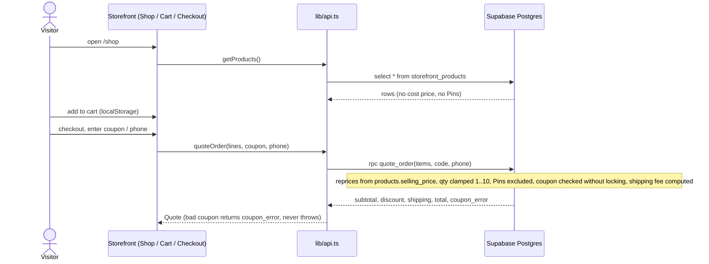

### 3.2 Checkout / place_order

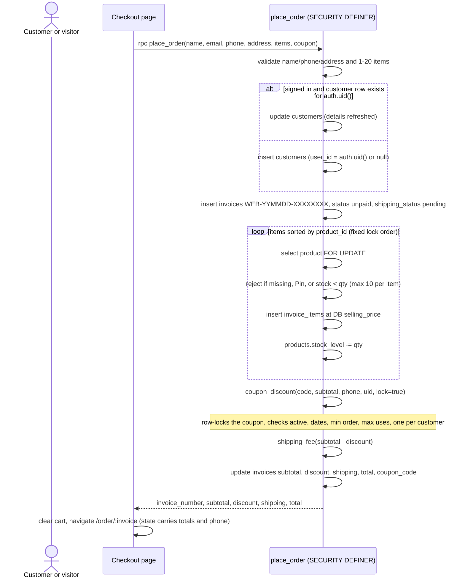

Any `raise exception` rolls the whole function back (invoice, customer, stock decrement) because it is one transaction. The UI shows the error message (for example "Only 2 left of X").

### 3.3 Sign-up / login and profile role trigger

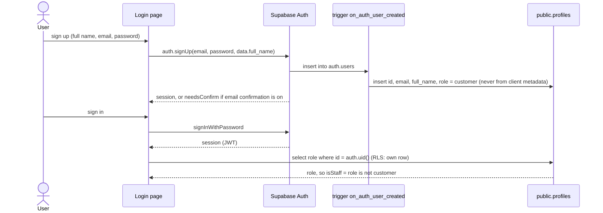

A `guard_role` trigger on `profiles` blocks anyone but an admin/manager (or the SQL editor / service role, where `auth.uid()` is null) from changing `role`, so the "update own profile" policy cannot be used to self-promote.

### 3.4 Admin order handling

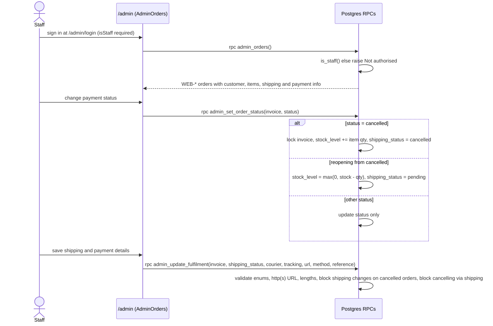

### 3.5 CRM product image upload

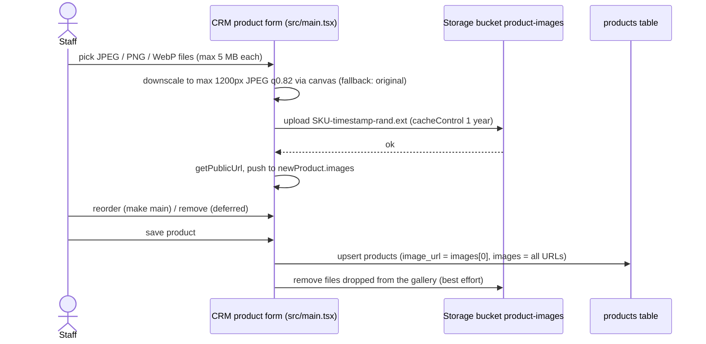

The storefront then renders those public URLs directly in ``.

### 3.6 Order tracking

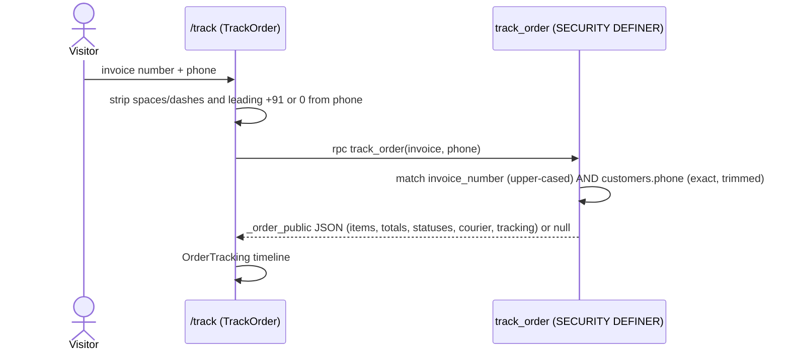

Logged-in customers see the same shape from `my_account()` on `/account`.

---

## 4. Security model

### Roles
- **anon**: not signed in. Uses the public anon key.
- **authenticated customer**: has a `profiles` row with `role = 'customer'` (default for all sign-ups).
- **staff**: `profiles.role <> 'customer'` (`staff`, `manager`, `admin`). `is_staff()` is true; `is_admin()` is true for `admin`/`manager`.
- Roles are changed only via the SQL editor/service role, or by an admin/manager (guarded by trigger).

### RLS and grants summary

| Object | anon | customer | staff |
|---|---|---|---|
| `storefront_products` (view) | select | select | select |
| `products`, `invoices`, `invoice_items`, `customers`, `suppliers` | none | none | all (policy "Staff full access", `is_staff()`) |
| `coupons` | none (revoked) | none | all (policy "Staff manage coupons") |
| `profiles` | none | select/update own row (role change blocked by trigger) | same; admin/manager may change roles |
| `quote_order`, `place_order`, `track_order` | execute | execute | execute |
| `my_account` | no | execute | execute |
| `admin_orders`, `admin_set_order_status`, `admin_update_fulfilment`, `admin_coupons` | no | execute granted, but body raises "Not authorised" unless `is_staff()` | works |
| `_shipping_fee`, `_coupon_discount`, `_order_public`, trigger functions | no | no | no (revoked from everyone; only called internally) |

All RPCs are `SECURITY DEFINER` with `set search_path = public, pg_temp`. The view `storefront_products` runs with owner rights (bypasses RLS), so it selects only safe columns; `revoke all` then `grant select` keeps it read-only.

### What anon can and cannot do
- Can: read non-Pin products (id, name, sku, category, brand, selling_price, stock_level, image_url, images, created_at); get quotes; place orders (priced and stock-checked server-side); track one order if it knows invoice number and phone; read public bucket images.
- Cannot: read `buying_price`, `supplier_id`, `serial_number`; read any base table; read coupons; list customers or orders; set prices; order Pins; call admin RPCs.

### Trust boundaries

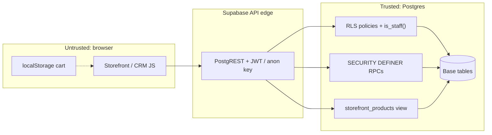

Rules of thumb: never trust client-side prices, stock, role, or cart contents; the anon key is public by design and is safe only because RLS and revoked grants are correct.

---

## 5. Business rules

- **Shipping**: flat Rs 80, free when `(subtotal - coupon discount) >= Rs 1500`. Defined in `_shipping_fee()`; `quote_order` also returns `free_shipping_threshold` and `shipping_flat` (hard-coded 1500 / 80 there, so change both places).
- **Coupons** (`coupons` table, staff-managed):
  - `type`: `percent` (value up to 100, discount = round(subtotal * value / 100, 2)) or `flat` (discount = min(value, subtotal)).
  - Code is upper-case/trimmed, 3-32 chars, unique.
  - Limits: `active`, `starts_at`, `expires_at`, `min_order` (against subtotal), `max_uses` (counts non-cancelled invoices with that code), `one_per_customer` (default true; matched by last 10 digits of phone or by `user_id`; cancelled orders do not count).
  - `quote_order` passes no phone (prevents probing which phones used a code); `place_order` enforces it and locks the coupon row `FOR UPDATE`.
  - Seed: `ATGC10` = 10% off, no minimum, unlimited uses, one per customer.
- **Stock**: `place_order` decrements `stock_level` immediately under row locks (ordered by product id). Cancelling restores; reopening a cancelled order re-takes (floored at 0). Max 10 per line, 1-20 lines per cart.
- **Pins hidden**: category `pins`/`pin` excluded in the view, `quote_order`, `place_order`, and the client filter.
- **Order numbers**: `WEB-YYMMDD-<8 hex>`; the admin list shows only `WEB-%` invoices (CRM invoices are separate).
- **Payment status** = `invoices.status` (shared with the CRM). `admin_set_order_status` accepts any of the five values; only cancel/reopen have stock side effects. The diagram shows the intended flow.

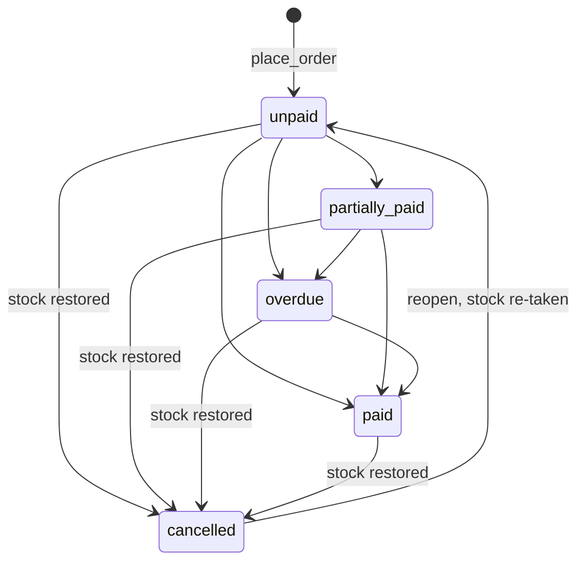

Reopening can target any non-cancelled status (drawn once for brevity).

- **Shipping status** = `invoices.shipping_status`. `admin_update_fulfilment` allows setting any of `pending, packed, shipped, out_for_delivery, delivered, returned` in any order (the UI timeline is the intended forward path). The DB forbids `cancelled` there and forbids any non-cancelled shipping status while payment status is `cancelled`. Payment methods: `upi, bank_transfer, cash, card, other`.

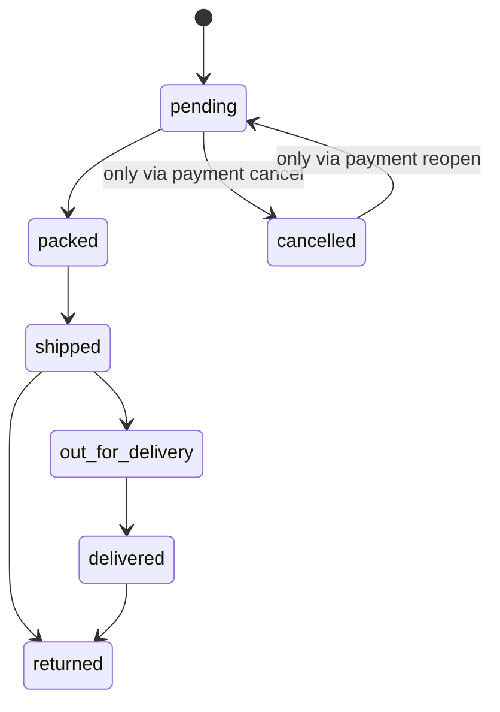

---

## 6. Deployment and environments

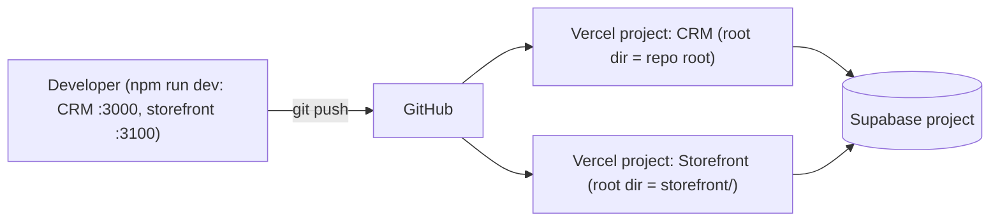

- Two Vercel projects from one repo; the storefront project's root directory is `storefront/`.
- `storefront/vercel.json` rewrites every path to `/` (SPA fallback for react-router).
- Build: storefront `npm run build` = `tsc --noEmit && vite build`; CRM `vite build`.
- Environment variables (names only; set per Vercel project and environment, and in local `.env` files):
  - Storefront: `VITE_SUPABASE_URL`, `VITE_SUPABASE_ANON_KEY` (read via `import.meta.env`).
  - CRM: `VITE_SUPABASE_URL`, `VITE_SUPABASE_ANON_KEY` (injected through `define` in `vite.config.ts` as `process.env.*`), `GEMINI_API_KEY` (in `.env.example` and the vite config; legacy from AI Studio).
- There is a single Supabase project and no separate staging database in the repo. Preview deployments hit the same data unless their env vars point elsewhere.
- Database setup is manual in the Supabase SQL editor, in this order: `supabase_schema.sql` (CRM base tables), `storefront/supabase/storefront.sql`, `accounts-admin.sql`, `shipping-coupons.sql` (last, safe to re-run), optionally `seed-products.sql`. The `product-images` bucket is created in the Supabase dashboard (public); its storage policies are not in the repo SQL.

---

## 7. Repository structure

```
Attrangi/
├─ package.json, vite.config.ts, tsconfig.json   CRM build config (Vite, env injected via define)
├─ index.html                                    CRM entry HTML
├─ src/
│  ├─ main.tsx                                   Entire CRM: state, router, handlers, render, Supabase calls, PDF export
│  ├─ lib/supabase.ts                            CRM Supabase client (anon key via process.env.*)
│  ├─ index.css                                  Tailwind + CRM styles
│  └─ vite-env.d.ts
├─ supabase_schema.sql                           Base CRM tables (suppliers, products, customers, invoices, ...)
├─ check-and-seed.ts, fix.cjs                    One-off maintenance scripts
├─ INITIALIZE.md, README.md, .env.example, metadata.json
├─ docs/ARCHITECTURE.md                          This file
└─ storefront/                                   Public shop (own package.json, own Vercel project)
   ├─ vercel.json                                SPA rewrite to /
   ├─ vite.config.ts                             react + @tailwindcss/vite
   ├─ index.html
   ├─ supabase/
   │  ├─ storefront.sql                          images column, storefront_products view, first track_order
   │  ├─ accounts-admin.sql                      profiles, role trigger, is_staff/is_admin, staff-only RLS, my_account, admin RPCs
   │  ├─ shipping-coupons.sql                    shipping columns, coupons, quote_order, place_order, track_order, admin RPCs (supersedes earlier versions)
   │  └─ seed-products.sql                       Catalog seed with bucket image names
   └─ src/
      ├─ main.tsx                                Providers + BrowserRouter bootstrap
      ├─ App.tsx                                 Route table
      ├─ index.css
      ├─ lib/         api.ts (all data access), auth.tsx (AuthProvider), cart.tsx (CartProvider),
      │               supabase.ts, types.ts, orderStatus.ts (labels/steps), format.ts (inr)
      ├─ components/  Layout, CartDrawer, ProductCard, Gallery, OrderTracking
      └─ pages/       Home, Shop, ProductPage, Checkout, OrderSuccess, TrackOrder, Login, Account
         └─ admin/    AdminLogin, AdminOrders, AdminCoupons
```

SQL file order matters: later files redefine functions from earlier ones (`place_order`, `track_order`, `my_account`, `admin_*`). `shipping-coupons.sql` is the source of truth.

---

## 8. Design decisions, trade-offs, risks

### Decisions
- **Database as the backend.** Pricing, stock, coupons, and authorization live in `SECURITY DEFINER` RPCs, so the SPA cannot be tricked into wrong prices and no server needs hosting. Trade-off: logic is in SQL, harder to test and version (no migration tool yet).
- **Shared tables.** Web orders are ordinary `invoices` (prefix `WEB-`), so the CRM sees them with no sync. Payment status reuses the CRM's `invoices.status` vocabulary.
- **Safe view instead of column grants** for public catalog reads, hiding cost price and Pins.
- **Guest checkout** with order lookup by invoice number plus phone; accounts are optional and link via `customers.user_id`.
- **Server-side quote** so the cart UI never computes trusted money values.
- **Role in `profiles`**, set only by trigger/admin; the CRM and `/admin` share the same Auth users.

### Known limitations and risks
- **Unpaid orders hold stock.** There is no online payment; stock decrements at order time and returns only on staff cancellation. No automatic expiry of unpaid orders.
- **One-per-customer coupon by phone** (last 10 digits) or `user_id`; a different phone number or fresh account bypasses it. Guest orders create a new `customers` row each time (duplicates).
- **Anon key is public** (shipped in the JS bundle). Security rests entirely on RLS and function grants; a mistake in SQL is directly exploitable. `place_order` has no rate limiting or CAPTCHA, so anonymous spam can lock stock and create orders.
- **Tracking uses phone as the secret.** `track_order` needs an exact match with the stored phone (the UI normalises input; stored formatting must match). Low-entropy secret; no rate limiting.
- **Open sign-ups**: staff protection depends on the `Staff full access` policies and the role-guard trigger. Per the migration notes, existing auth users become staff when `accounts-admin.sql` runs; review them first.
- **CRM stock updates are client-side read-modify-write** (select `stock_level`, then update), not atomic, and can race with web orders (the storefront RPC is atomic).
- **Shipping threshold/fee are hard-coded** in SQL (and echoed in `quote_order`).
- **Single environment**: previews and production share one database.
- **CRM is a ~2,400-line single file** with a custom render loop; changes are risky. Neither app has automated tests.
- Storage bucket policies are configured in the dashboard and are not versioned in the repo.

### Future improvements
- Online payments (UPI/gateway webhook) with order expiry that releases stock for unpaid orders.
- Move CRM stock changes to RPCs (atomic) and add a stock movement/audit table.
- Versioned migrations (Supabase CLI), a staging Supabase project, and CI running `tsc` and SQL tests.
- Rate limiting / CAPTCHA on `place_order`, `track_order`, `quote_order`; a stronger tracking token (emailed link or OTP).
- Normalise phone numbers at write time; deduplicate guest customers.
- Order confirmation emails and shipping notifications.
- Split the CRM into modules or port it to React.
