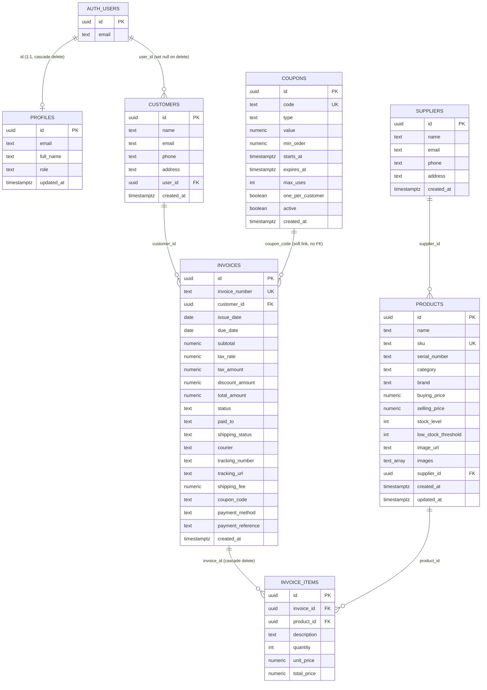
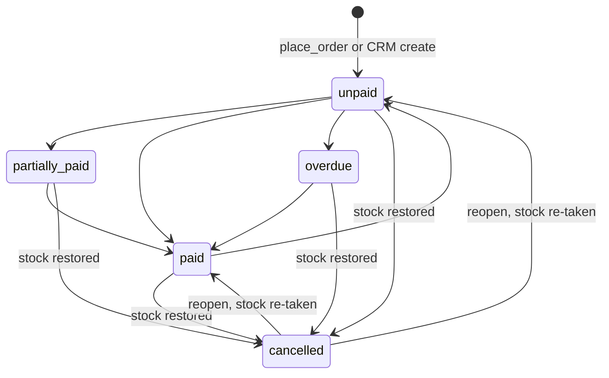
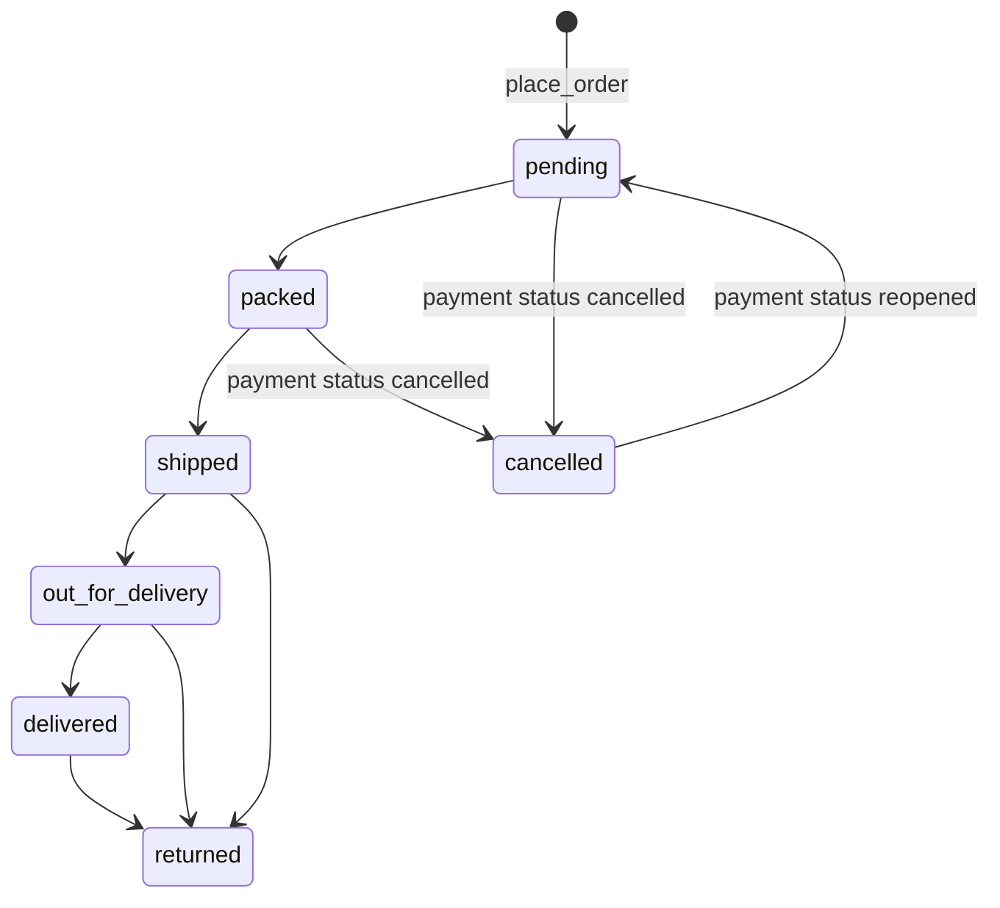

# Attrangii Database Reference

Supabase (PostgreSQL) backing both the **CRM** (`src/main.tsx`, staff) and the **public storefront** (`storefront/`). Both apps share the same tables; the storefront reads and writes only through a view and SECURITY DEFINER RPCs.

This document describes the schema **after** running, in order:

1. `supabase_schema.sql` (repo root, base CRM schema)
2. `storefront/supabase/storefront.sql`
3. `storefront/supabase/accounts-admin.sql`
4. `storefront/supabase/shipping-coupons.sql`
5. `storefront/supabase/seed-products.sql` (data only; needs `products.images` from step 2)

## 1. Entity-relationship diagram



(`profiles.id` is both PK and FK to `auth.users.id`. `invoices.paid_to` is used by the CRM but is in no migration here, see 2.5.)

Relationship notes:
- `invoices.coupon_code` is a plain text copy of `coupons.code`, not a foreign key, so coupons can be edited without touching history; usage is counted by matching text.
- Web orders and CRM invoices share `invoices`. Web orders are recognised by `invoice_number LIKE 'WEB-%'`; CRM invoices use `INV-<6 digits>`.
- `invoice_items.product_id` has no `ON DELETE` clause (default restrict): a product that has been ordered cannot be deleted (the seed relies on this).

## 2. Tables

### 2.1 `profiles`
One row per `auth.users` row. Created by trigger `on_auth_user_created`.

| Column | Type | Default | Constraints | Notes |
|---|---|---|---|---|
| id | uuid | - | PK, FK `auth.users(id)` ON DELETE CASCADE | |
| email | text | - | - | copied at sign-up |
| full_name | text | - | - | from `raw_user_meta_data->>'full_name'` |
| role | text | `'customer'` | none (free text) | Base schema default was `'staff'`; accounts-admin.sql changes it to `'customer'`. `customer` = shopper; any other value = staff; `admin`/`manager` may change roles |
| updated_at | timestamptz | `now()` | - | not auto-maintained |

### 2.2 `customers`
| Column | Type | Default | Constraints | Notes |
|---|---|---|---|---|
| id | uuid | `uuid_generate_v4()` | PK | needs `uuid-ossp` |
| name | text | - | NOT NULL | |
| email | text | - | - | |
| phone | text | - | - | `track_order` matches phone exactly (trimmed); coupon check compares last 10 digits |
| address | text | - | - | |
| created_at | timestamptz | `now()` | - | |
| user_id | uuid | - | FK `auth.users(id)` ON DELETE SET NULL | added by accounts-admin.sql; links a customer to a logged-in shopper; NULL for guest checkout and CRM-created customers |

### 2.3 `suppliers`
| Column | Type | Default | Constraints | Notes |
|---|---|---|---|---|
| id | uuid | `uuid_generate_v4()` | PK | |
| name | text | - | NOT NULL | |
| email, phone, address | text | - | - | |
| created_at | timestamptz | `now()` | - | |

### 2.4 `products`
| Column | Type | Default | Constraints | Notes |
|---|---|---|---|---|
| id | uuid | `uuid_generate_v4()` | PK | |
| name | text | - | NOT NULL | |
| sku | text | - | UNIQUE NOT NULL | see section 9 |
| serial_number | text | - | - | hidden from storefront |
| category | text | - | - | free text; `Pins`/`Pin` hidden from storefront |
| brand | text | - | - | |
| buying_price | numeric(10,2) | 0 | - | hidden from storefront; seed leaves 0 |
| selling_price | numeric(10,2) | 0 | - | resale price, Rs |
| stock_level | int | 0 | - | no CHECK >= 0; RPCs guard it |
| low_stock_threshold | int | 10 | - | seed uses 2 |
| image_url | text | - | - | main image URL (section 7) |
| supplier_id | uuid | - | FK `suppliers(id)` | |
| created_at | timestamptz | `now()` | - | |
| updated_at | timestamptz | `now()` | - | set manually by `place_order`; no trigger |
| images | text[] | `'{}'` | NOT NULL | added by storefront.sql; gallery, main image first |
| show_on_storefront | boolean | `true` | NOT NULL | added by storefront.sql; `false` hides the product from the public store only (it stays in the CRM). Toggle it with the "Show on website" checkbox in the CRM product form |

### 2.5 `invoices`
| Column | Type | Default | Constraints | Notes |
|---|---|---|---|---|
| id | uuid | `uuid_generate_v4()` | PK | |
| invoice_number | text | - | UNIQUE NOT NULL | CRM `INV-NNNNNN`; web `WEB-YYMMDD-XXXXXXXX` |
| customer_id | uuid | - | FK `customers(id)` | |
| issue_date | date | `CURRENT_DATE` | - | |
| due_date | date | - | - | |
| subtotal | numeric(10,2) | 0 | - | sum of line totals before discount |
| tax_rate | numeric(5,2) | 18.00 | - | web orders set 0 |
| tax_amount | numeric(10,2) | 0 | - | |
| discount_amount | numeric(10,2) | 0 | - | coupon discount for web orders |
| total_amount | numeric(10,2) | 0 | - | web: subtotal - discount + shipping |
| status | text | `'unpaid'` | none (no CHECK) | payment status: unpaid, paid, partially_paid, overdue, cancelled. Validated only inside `admin_set_order_status`; the CRM writes lower-cased values directly |
| paid_to | text | - | - | **Used by the app / added by migrations outside this repo.** CRM "paid to" receiver (MEHUL, SIMARPREET, DALBIR). Not in any SQL file here; add if missing: `alter table invoices add column if not exists paid_to text;` |
| shipping_status | text | `'pending'` | NOT NULL, no CHECK | pending, packed, shipped, out_for_delivery, delivered, returned, cancelled; validated in `admin_update_fulfilment` |
| courier | text | - | - | |
| tracking_number | text | - | - | |
| tracking_url | text | - | - | must be http(s) (RPC validated) |
| shipping_fee | numeric(10,2) | 0 | NOT NULL | Rs 80 or 0 |
| coupon_code | text | - | - | uppercase code applied |
| payment_method | text | - | - | upi, bank_transfer, cash, card, other (RPC validated) |
| payment_reference | text | - | - | e.g. UPI txn id; staff-only (only `admin_orders` returns it) |
| created_at | timestamptz | `now()` | - | |

### 2.6 `invoice_items`
| Column | Type | Default | Constraints | Notes |
|---|---|---|---|---|
| id | uuid | `uuid_generate_v4()` | PK | |
| invoice_id | uuid | - | FK `invoices(id)` ON DELETE CASCADE | |
| product_id | uuid | - | FK `products(id)` | |
| description | text | - | - | product name snapshot |
| quantity | int | 1 | - | web max 10 per line |
| unit_price | numeric(10,2) | 0 | - | price snapshot |
| total_price | numeric(10,2) | 0 | - | unit_price x quantity |

### 2.7 `coupons` (shipping-coupons.sql)
| Column | Type | Default | Constraints | Notes |
|---|---|---|---|---|
| id | uuid | `gen_random_uuid()` | PK | |
| code | text | - | NOT NULL, UNIQUE, CHECK `code = upper(trim(code))` and length 3-32 | store uppercase |
| type | text | - | NOT NULL, CHECK in (`percent`,`flat`) | |
| value | numeric(10,2) | - | NOT NULL, CHECK > 0; percent also <= 100 | percent points or Rs |
| min_order | numeric(10,2) | 0 | NOT NULL, CHECK >= 0 | compared to item subtotal |
| starts_at | timestamptz | - | - | NULL = no start bound |
| expires_at | timestamptz | - | - | NULL = never |
| max_uses | int | - | CHECK NULL or > 0 | NULL = unlimited; counts non-cancelled invoices |
| one_per_customer | boolean | true | NOT NULL | match by phone (last 10 digits) or user id |
| active | boolean | true | NOT NULL | |
| created_at | timestamptz | `now()` | NOT NULL | |

Seed row: `ATGC10`, percent 10, min 0, one per customer, active.

## 3. View: `public.storefront_products`

```sql
select id, name, sku, category, brand, selling_price, stock_level, image_url, created_at, images
from public.products
where lower(coalesce(category,'')) not in ('pins','pin');
```
- **Exposed:** id, name, sku, category, brand, selling_price, stock_level, image_url, created_at, images.
- **Hidden:** buying_price, supplier_id, serial_number, low_stock_threshold, updated_at.
- **Hidden products:** rows with `show_on_storefront = false` are excluded, and so are the products they stand for in `quote_order` / `place_order` ("Product not found"). `storefront/supabase/hide-products.sql` is the patch that added the switch and hid the first 21 products.
- **Pins filter:** category `pins` or `pin` (case-insensitive) is excluded. `place_order` and `quote_order` also refuse/ignore Pins, so they cannot be bought by crafting an RPC call.
- **Grants:** `revoke all ... from anon, authenticated; grant select ... to anon, authenticated;`. The view runs as its owner (bypasses `products` RLS, and is auto-updatable), hence the explicit SELECT-only grant.

## 4. Functions / RPC catalogue

All in schema `public`. SD = SECURITY DEFINER. All SD functions pin `search_path`.

| Function | SD | Who can execute | Final definition |
|---|---|---|---|
| `place_order(p_name, p_email, p_phone, p_address, p_items jsonb, p_coupon text default null) returns jsonb` | yes | anon, authenticated | shipping-coupons.sql |
| `quote_order(p_items jsonb, p_code text default null, p_phone text default null) returns jsonb` | yes (stable) | anon, authenticated | shipping-coupons.sql |
| `track_order(p_invoice_number text, p_phone text) returns jsonb` | yes | anon, authenticated | shipping-coupons.sql (supersedes storefront.sql) |
| `my_account() returns jsonb` | yes | authenticated only | shipping-coupons.sql (supersedes accounts-admin.sql) |
| `admin_orders() returns jsonb` | yes | authenticated, staff-only inside | shipping-coupons.sql (supersedes accounts-admin.sql) |
| `admin_set_order_status(p_invoice_number, p_status) returns void` | yes | authenticated, staff-only inside | shipping-coupons.sql (supersedes accounts-admin.sql) |
| `admin_update_fulfilment(p_invoice_number, p_shipping_status, p_courier, p_tracking_number, p_tracking_url, p_payment_method, p_payment_reference) returns void` | yes | authenticated, staff-only inside | shipping-coupons.sql |
| `admin_coupons() returns jsonb` | yes (stable) | authenticated, staff-only inside | shipping-coupons.sql |
| `_coupon_discount(p_code, p_subtotal, p_phone, p_uid, p_lock) returns jsonb` | yes | internal (revoked from public, anon, authenticated) | shipping-coupons.sql |
| `_shipping_fee(p_net numeric) returns numeric` | no (immutable) | internal | shipping-coupons.sql |
| `_order_public(i invoices) returns jsonb` | yes | internal | shipping-coupons.sql |
| `is_staff() returns boolean` | yes (stable) | authenticated (used by RLS) | accounts-admin.sql |
| `is_admin() returns boolean` | yes (stable) | authenticated | accounts-admin.sql |
| `handle_new_user()` trigger fn | yes | nobody (revoked) | accounts-admin.sql |
| `guard_role_change()` trigger fn | yes | nobody (revoked) | accounts-admin.sql |

### Supersession summary
- `place_order`: shipping-coupons.sql drops **every** existing overload of `place_order` with a DO block, then creates the 6-arg version. Only that one exists afterwards.
- `track_order` (storefront.sql: id, status, date, total, items only) is replaced by a version returning the `_order_public` shape.
- `my_account`, `admin_orders`, `admin_set_order_status` (accounts-admin.sql) are `create or replace`d with richer output; the status function now also drives `shipping_status`.
- The storefront.sql and accounts-admin.sql files only carry comments pointing at shipping-coupons.sql for `place_order`.

### Details

**place_order** - Creates customer, invoice and items atomically, priced server-side.
- Requires non-empty name, phone, address; cart of 1-20 items; qty coerced to at least 1, above 10 raises `Max 10 per item`.
- Logged-in caller (`auth.uid()`): reuses and updates the customer linked by `user_id` (email only overwritten when a new one is supplied); otherwise inserts a new customer (guests get `user_id` null).
- Number `WEB-YYMMDD-XXXXXXXX`; invoice inserted `unpaid`, `tax_rate 0`, `shipping_status pending`.
- Items processed in `product_id` order with `FOR UPDATE` row locks (deadlock avoidance). Rejects missing product, Pins, null price, or insufficient stock (`Only N left of <name>`). Stock is decremented immediately and `updated_at` set.
- Coupon applied with row lock; a non-blank but invalid coupon raises its error message and the whole order rolls back.
- Returns `{invoice_number, subtotal, discount, shipping, total}`.

**quote_order** - Same maths, no writes. Never raises on a bad coupon; returns `coupon_error` instead. Passes a null phone to the coupon check (prevents probing which phones used a code); `place_order` enforces the per-customer limit (the logged-in uid is still honoured in quotes). Pins and unknown products are silently excluded from the subtotal. Returns `subtotal, discount, shipping, total, coupon_code (only when valid), coupon_error, free_shipping_threshold (1500), shipping_flat (80)`. Cart 1-20 items, qty clamped 1-10.

**track_order** - Returns `_order_public(invoice)` when `invoice_number = upper(trim(arg))` and `customers.phone = trim(arg)` exactly; NULL otherwise. Both values are needed so an invoice number alone leaks nothing. Does not expose `payment_reference` or customer details.

**my_account** - `{customer: {name,email,phone,address} | null, orders: [...]}` for the caller's linked customer (id, user_id, created_at stripped); orders newest first.

**admin_orders** - Staff only (`Not authorised` otherwise). All `WEB-%` invoices newest first: `_order_public` plus `id, created_at, payment_reference, customer{name,email,phone,address}`.

**admin_set_order_status** - Staff only. Status must be one of unpaid, paid, partially_paid, overdue, cancelled. Locks the invoice; no-op if unchanged.
- To `cancelled`: adds each line's quantity back to stock; sets `shipping_status = 'cancelled'`.
- From `cancelled` to anything: re-takes stock (`greatest(0, stock - qty)`, so it floors at 0 and can oversell) and resets `shipping_status = 'pending'`.
- Any other transition changes only `status`.
- Accepts any invoice number, including CRM `INV-` ones.

**admin_update_fulfilment** - Staff only; `WEB-%` orders only. Validates shipping status (seven values), payment method (`upi, bank_transfer, cash, card, other` or blank), tracking URL (`^https?://` and no whitespace/quotes/angle brackets), and 300-char max on courier/tracking number/URL/reference. Blank strings stored as NULL. Guards: a cancelled order cannot take a non-cancelled shipping status ("reopen it first"); a non-cancelled order cannot be set to shipping `cancelled` (cancel via payment status so stock is restored).

**admin_coupons** - Staff only. All coupon columns plus `used` (count of non-cancelled invoices with that code), newest first.

**_coupon_discount** - Internal. Returns `{code, discount, error}`. Checks in order: blank code (no-op), exists and `active`, `starts_at`, `expires_at`, `min_order` vs item subtotal, `max_uses` (non-cancelled invoices), `one_per_customer` (non-cancelled invoice with the same code from a customer with the same last-10-digit phone or same `user_id`). Discount: percent = `round(subtotal * value / 100, 2)`; flat = `least(value, subtotal)`. With `p_lock = true` the coupon row is locked `FOR UPDATE`, so concurrent orders cannot exceed `max_uses`.

**_shipping_fee** - `net >= 1500 -> 0, else 80`. To change the rule edit this function, and the `1500`/`80` labels in `quote_order`.

**_order_public** - Customer-safe order JSON: invoice_number, status, issue_date, subtotal, discount, shipping, total, coupon_code, shipping_status, courier, tracking_number, tracking_url, payment_method, items[{description, quantity, unit_price}].

**is_staff / is_admin** - `is_staff`: caller has a profile with `role <> 'customer'`. `is_admin`: role in (`admin`,`manager`). No profile row means neither.

**handle_new_user** - After insert on `auth.users`: inserts a profile with role **always** `'customer'` (never read from client metadata); `on conflict do nothing`.

**guard_role_change** - Before update on `profiles`: if `role` changes, `auth.uid()` is not null, and the caller is not admin/manager, raises `Not allowed to change role`. SQL editor / service role (uid null) bypass it.

## 5. Triggers

| Trigger | Table | Timing | Function | Purpose |
|---|---|---|---|---|
| `on_auth_user_created` | `auth.users` | AFTER INSERT, each row | `handle_new_user()` | create customer-role profile |
| `guard_role` | `public.profiles` | BEFORE UPDATE, each row | `guard_role_change()` | block role self-escalation |

No `updated_at` triggers exist.

## 6. Row Level Security and role model

RLS is enabled on products, invoices, invoice_items, customers, suppliers, profiles, coupons.

### Role model
- **customer** (default for every sign-up): can use the storefront view and RPCs, and read/update their own profile row (not its role).
- **staff** (any other role value, e.g. `staff`): full access to CRM tables via RLS and the `admin_*` RPCs.
- **admin / manager**: staff, plus may change roles.
- accounts-admin.sql promotes every pre-existing `auth.users` row to `staff`. Run `select email, created_at from auth.users;` first and demote any shop customers who registered earlier.

### Policies (final state)
| Table | Policy | Command / role | Rule |
|---|---|---|---|
| products, invoices, invoice_items, customers, suppliers | `Staff full access` | ALL, `authenticated` | USING and WITH CHECK `public.is_staff()` |
| profiles | `Users can view their own profile` | SELECT | `auth.uid() = id` |
| profiles | `Users can update their own profile` | UPDATE | `auth.uid() = id` (role change blocked by `guard_role`) |
| coupons | `Staff manage coupons` | ALL, `authenticated` | `is_staff()` for USING and WITH CHECK; also `revoke all from anon` |

The base policies (`Allow all to authenticated`, `Permit all on customers/suppliers`) are **dropped** by accounts-admin.sql: a DO block drops every policy on the five CRM tables (including any you added) before creating `Staff full access`. `profiles` has no INSERT/DELETE policy (rows come from the trigger or SQL editor). Anonymous visitors have no direct table access.

### Promote a user to staff / admin
Run in the SQL editor (`auth.uid()` is null there, so `guard_role` allows it):
```sql
update public.profiles set role = 'staff'    where email = 'person@example.com';
update public.profiles set role = 'admin'    where email = 'person@example.com';  -- can manage roles
update public.profiles set role = 'customer' where email = 'person@example.com';  -- demote
```
If the profile row is missing:
```sql
insert into public.profiles (id, email, role)
select id, email, 'staff' from auth.users where email = 'person@example.com'
on conflict (id) do update set role = excluded.role;
```

## 7. Storage: `product-images`

- Public Supabase Storage bucket. Created in the dashboard; no SQL for it (or its storage policies) exists in these files. URL form: `https://<project>.supabase.co/storage/v1/object/public/product-images/<file>`.
- **CRM uploads** (`src/main.tsx`): image downscaled client-side to max 1200 px JPEG quality 0.82 (original on failure), max 5 MB per file, name `<sku with [^A-Za-z0-9_-] replaced by _>-<Date.now()>-<4 random chars>.<ext>`, `upsert: false`, `cacheControl: 31536000` (1 year, so always upload under a new name, never overwrite).
- **Seed images** are hand-named: `blokees-01.jpg`, `bricks-09.jpg`, `naruto-11.jpg`, `demon-slayer-03.jpg`, `pokeballs-02.jpg`, etc.
- Removing an image in the CRM defers the storage delete until the product is saved; only URLs containing `/product-images/` are removed (best effort).

### `image_url` vs `images[]`
- `images text[]` is the ordered gallery; **element 1 (index 0 in JS) is the main image**.
- `image_url` is the main image, a denormalised copy of that first element. CRM saves `image_url = imgs[0] ?? null` and `images = imgs`; "make main" moves a URL to the front.
- Legacy rows may only have `image_url`; the CRM then treats the gallery as `[image_url]`, and the list thumbnail falls back to `images[0]` when `image_url` is empty.
- If the `images` column is missing, the CRM retries the save without it.
- The seed fills `image_url`/`images` only when empty and repairs old relative `/products/...` paths in `image_url`.

## 8. Status enums

### `invoices.status` (payment status)

`admin_set_order_status` permits any move between the five values; the diagram shows the meaningful ones. No CHECK constraint exists; the CRM UI writes lower-cased values straight to the table (and restores stock client-side when deleting or editing invoices).

### `invoices.shipping_status`

`admin_update_fulfilment` allows any of the seven values (subject to the cancelled guards in section 4); the diagram is the intended flow. `cancelled` is reached only via `admin_set_order_status('cancelled')`, which restores stock; reopening resets to `pending` and re-takes stock.

Stock summary: placing an order decrements stock; cancelling adds it back; reopening subtracts again (floored at 0); a `returned` shipping status does not touch stock (adjust manually).

## 9. Conventions and pricing maths

### Order numbers
`WEB-YYMMDD-XXXXXXXX`: `WEB-`, date from `now()` (server timezone, normally UTC), `-`, 8 uppercase hex characters from `md5(gen_random_uuid()::text)`. Example: `WEB-261017-3F9A12BC`. `track_order` upper-cases its input. CRM invoices: `INV-` plus the last 6 digits of `Date.now()`.

### SKU conventions
UPPERCASE, hyphen-separated, unique. Per-design products use `<FAMILY>-<CODE or NAME>`: `BRICKS-F3022-RED-MASKED-HERO`, `NARUTO-SHINOBI-01-WHITE-DRAGON`, `DEMON-SLAYER-TANJIRO`, `POKEBALL-PIKACHU`. Brand prefixes: `ZD-`, `MES-`, `GOW-`. The SKU also prefixes uploaded image filenames.

### Pricing (server-side in `place_order` / `quote_order`)
```
subtotal = sum(selling_price * qty)
discount = percent: round(subtotal * value / 100, 2) ; flat: min(value, subtotal)
net      = subtotal - discount
shipping = net >= 1500 ? 0 : 80
total    = net + shipping
```
No tax on web orders (`tax_rate 0`). Free shipping is judged on the **post-discount** amount.

| Cart | Coupon | Subtotal | Discount | Net | Shipping | Total |
|---|---|---|---|---|---|---|
| Rs 350 item (Blokees) | none | 350 | 0 | 350 | 80 | **430** |
| Pokeball Rs 1400 | ATGC10 (10%) | 1400 | 140 | 1260 | 80 | **1340** |
| Rs 2800 (2 Pokeballs) | ATGC10 | 2800 | 280 | 2520 | 0 | **2520** |
| Rs 1600 (F1 Blocks) | ATGC10 | 1600 | 160 | 1440 | 80 | **1520** (discount drops net below 1500) |

## 10. Operations

### Run order and idempotency
1. `supabase_schema.sql`: **not idempotent** (plain `CREATE TABLE` / `CREATE POLICY`; needs `create extension if not exists "uuid-ossp";`). Run once on an empty project. Its `profiles` table was reportedly never created in the live project, which is why accounts-admin.sql creates it `if not exists`.
2. `storefront.sql`: re-runnable (`add column if not exists`, `create or replace`).
3. `accounts-admin.sql`: re-runnable, but each run re-promotes any auth user lacking a profile to `staff` and **drops and recreates all policies** on the five CRM tables. Do the `select email from auth.users` check first.
4. `shipping-coupons.sql`: re-runnable (`if not exists`, drop/recreate `place_order`, `on conflict do nothing` for the seed coupon).
5. `seed-products.sql`: re-runnable. Existing SKUs keep stock and price (conflict only fills missing images); per-design inserts `do nothing`. It deletes the old combined products `BRICKS`, `NARUTO`, `DEMON-SLAYER` only if never ordered (otherwise zeroes their stock), and renames the legacy `POKEBALLS` row to `POKEBALL-SQUIRTLE`. The header says "26 products" but the first block inserts 22 rows; the rest come from the per-design inserts.
6. Outside these files: `invoices.paid_to` and the `product-images` bucket with its storage policies.

### Add a product
- CRM: Inventory, add product (upload images; the first is main).
- SQL:
```sql
insert into public.products (name, sku, category, selling_price, stock_level, low_stock_threshold, image_url, images)
values ('My Toy', 'MY-TOY', 'Toys & Novelty', 500, 3, 2, null, '{}');
```
Reuse one of the existing category names exactly. Category `Pins` keeps it off the shop.

### Add a coupon
```sql
insert into public.coupons (code, type, value, min_order, expires_at, max_uses, one_per_customer)
values ('DIWALI15', 'percent', 15, 500, '2026-11-15 23:59+05:30', 100, true);
-- flat Rs 100 off:  values ('FLAT100', 'flat', 100, 999, null, null, true)
-- disable:          update public.coupons set active = false where code = 'ATGC10';
```
Codes must be uppercase, 3-32 chars. Staff can see usage via `admin_coupons()`.

### Backup / rollback hints
- Before any migration: Dashboard, Database, Backups (or PITR), or `pg_dump --schema=public` (schema and data).
- Cheap snapshot before reseeding: `create table products_bak as table products;` (drop after verifying).
- Rolling back accounts-admin.sql: drop the `Staff full access` policies and recreate the old open ones (insecure once sign-ups are open), drop the trigger and functions. Prefer fixing forward.
- shipping-coupons.sql: the new columns are additive and harmless; drop `coupons` and the functions only if nothing calls them.
- Prefer `admin_set_order_status(..., 'cancelled')` over deleting invoices. Deleting a web invoice in SQL does not restore stock; the CRM delete does it client-side.

### Indexes
- Explicit: `invoices_coupon_code_idx` on `invoices(coupon_code) where coupon_code is not null`.
- Implicit: primary keys; unique on `products.sku`, `invoices.invoice_number`, `coupons.code`.
- None on foreign keys or `customers.phone`. If data grows, consider `customers(user_id)`, `customers(phone)`, `invoices(customer_id)`, `invoice_items(invoice_id)`, `invoice_items(product_id)`.

## 11. Current catalog (after seed)

55 products in total, of which 21 are hidden from the store with `show_on_storefront = false` (34 visible). The Pins category exists in the DB and CRM but has no seeded rows; it is hidden by the view and refused by `place_order` / `quote_order`.

| Category | Count | Contents |
|---|---|---|
| Building Blocks | 30 | F1 Blocks (Rs 1600), Blokees (350), F1 Lego Cars (1600); **Bricks, 15 designs** at Rs 300 (stock 1 each); **Naruto Shinobi, 4 designs** at Rs 500 (stock 2); **Demon Slayer, 8 designs** at Rs 400 (stock 2) |
| Toys & Novelty | 8 | Bubbles (250), Ironman Mystery Box (450); **Pokeballs, 6 designs** (Squirtle, Meowth, Pikachu, Eevee, Bulbasaur, Charmander) at Rs 1400, stock 1 each |
| Action Figures & Statues | 10 | Marvel Infinity (450), Predator (3000), Terminator (2500), Buzz - Toy Story (1000), Mes Toys Spiderman with Tentacles (4000), ZD Toys Deadpool (3700), ZD Toys Wolverine (3700), ZD Toys Mark 85 Iron Man (4000), Spiderman on Stone (1800), Spiderman Mask Jaw Movement (1000) |
| Gaming Collectibles | 7 | Mario (1000), Valorant Jet (1200), Genshin Impact (1000), GTA (1000), Halo (3000), God of War: Ghost of Sparta (3500), God of War Statue (2000) |

Retired combined products `BRICKS`, `NARUTO`, `DEMON-SLAYER` are removed if never ordered, else left with stock 0 (still visible in the view). Products without images show a placeholder. Seed image URLs hard-code this project's storage host; change them if you move projects.
