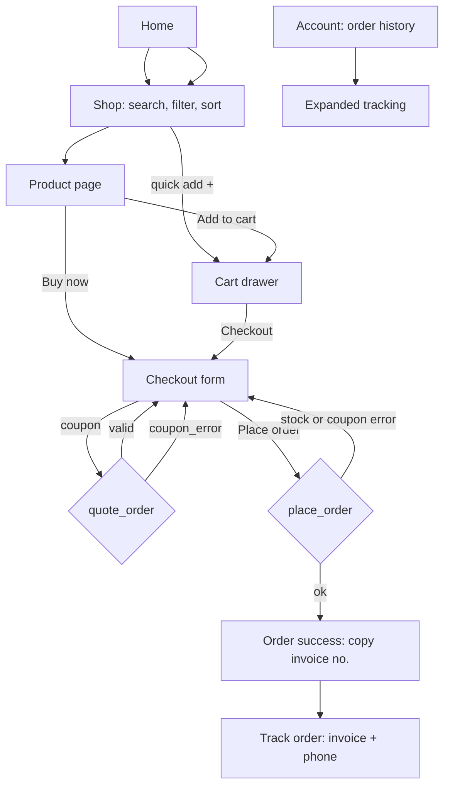
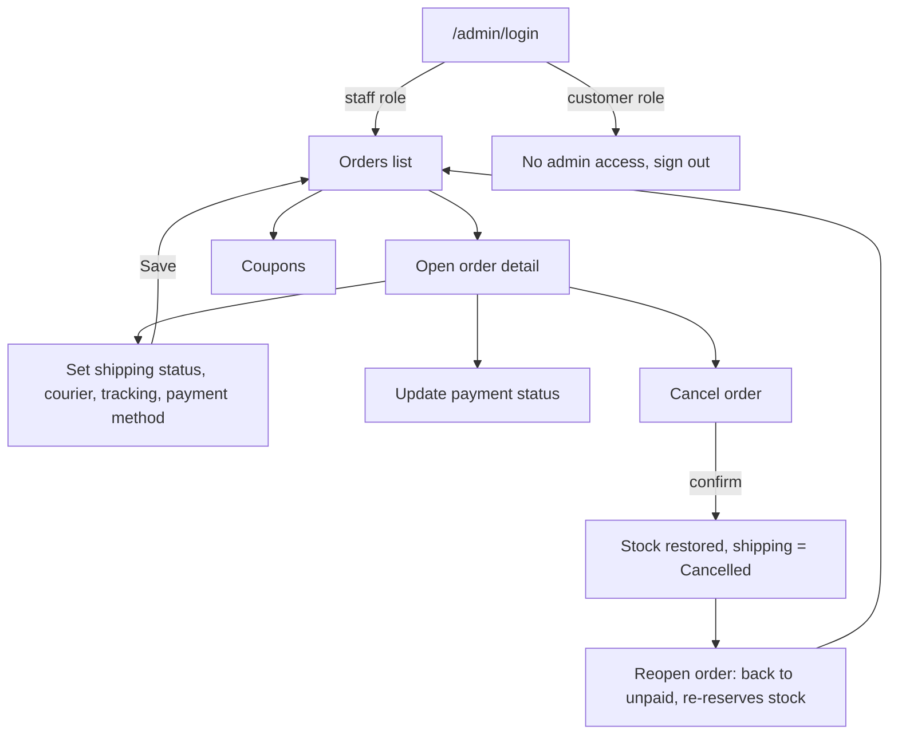
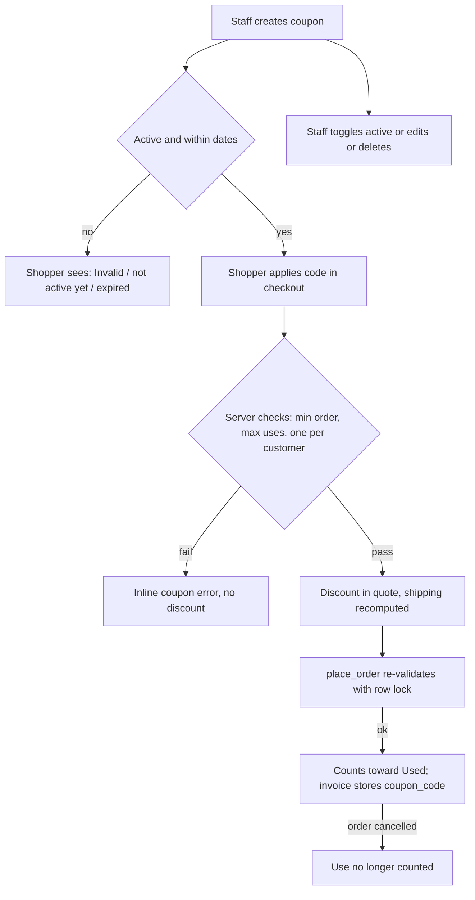

# Attrangii Storefront: Design System

Documents the design as implemented in `storefront/src`. Tokens live in `src/index.css`; everything else is Tailwind v4 utility classes inside components. There is no component library; the patterns below are repeated by convention.

## 1. Brand and visual identity

Playful, colourful, gift-and-collectibles shop (Lego-style bricks, anime figures, pokeballs). Tagline on Home: "Add a splash of color to everything". The look is light and airy: white pages, a blush-pink wash (`soft`) for panels and the hero, bubblegum pink as the single action colour, with sky blue and sun yellow as sparing accents. Headings use a heavy geometric display face; body copy is a friendly humanist sans. Large rounded corners and pill buttons carry the "playful" feel; the logo is `public/logo.png` next to an "Attrangii" wordmark in brand pink.

## 2. Colour tokens

Defined in `@theme` in `index.css`; each becomes utilities such as `bg-brand`, `text-muted`, `border-line`.

| Token | Value | Used for |
|---|---|---|
| `brand` | `#E87AAE` | Primary buttons, wordmark, active chips/tabs, focus outline, cart badge, timeline done steps, switch "on", initials placeholders (`bg-brand/15`), hero accent word |
| `brand-dark` | `#d4609a` | Button hover, text links, prices on cards, active nav, required-field asterisk. (Used for text because it reads better than `brand` on white.) |
| `sky` | `#5FA8C9` | Brand name on product page (`text-sky`), category tile tint (`bg-sky/20`) |
| `sun` | `#F4D21F` | "Only N left" badge on cards, category tile tint (`bg-sun/30`) |
| `ink` | `#1a1a1a` | Body text, "Buy now" outline button, "Out of stock" badge, lightbox close icon |
| `muted` | `#666` | Secondary text, labels, placeholders, breadcrumbs |
| `line` | `#eee` | Borders, dividers, skeleton blocks on Home, inactive timeline circle, disabled button fill |
| `soft` | `#fdf5f9` | Hero, footer, admin page background, panels, skeleton blocks, hover fill on icon buttons, tab track |

Tailwind default colours used for status/feedback (not tokens): red (errors, cancelled, destructive), green (paid, discounts, in stock), amber (unpaid), sky-100/800 (partially paid), indigo-50/800 (shipping badge in admin), orange-600 (low stock text), gray (cancelled, switch off, admin skeletons). Overlays are `bg-black/40` (drawers) and `bg-black/90` (lightbox).

## 3. Typography

Fonts: **Epilogue** (500/700/900) as `font-display`, **Plus Jakarta Sans** (400-700) as `font-sans`, both from Google Fonts. Base: body is Plus Jakarta Sans in `ink` on white; `h1-h3` automatically use Epilogue with `letter-spacing: -0.02em`.

| Role | Classes in use |
|---|---|
| Hero H1 | `text-4xl sm:text-6xl font-black` |
| Page H1 | `text-3xl font-bold` (checkout, track, account, login) or `text-3xl sm:text-4xl font-black` (shop, product) |
| Section H2 | `text-2xl font-black` (Home, related); `text-xl font-bold` (account orders); `text-lg font-bold` (summary, drawers) |
| Price (product page) | `font-display text-3xl font-bold` |
| Body | default (16px); inputs `text-base` on customer forms to avoid iOS zoom |
| Small / labels | `text-sm`, `text-sm font-medium` for field labels |
| Meta / badges | `text-xs`, `text-xs font-semibold`, `uppercase tracking-wide` for category and brand |
| Money / codes | `font-mono font-semibold` for coupon codes (admin); `font-display` for order numbers and stat numbers |

Currency is formatted by `inr()` as en-IN rupees with no decimals (for example `₹1,600`).

## 4. Spacing, radius, shadow, motion

- **Page container**: `mx-auto max-w-6xl px-4` (Layout, Home, product, admin); `max-w-7xl px-4 sm:px-6` for Shop; narrow forms use `max-w-md` (login, success), `max-w-lg` (track), `max-w-2xl` (account), `max-w-5xl` (checkout).
- **Vertical rhythm**: sections `py-8` to `py-16`; hero `py-16 sm:py-24`; stacked form fields `space-y-4`; grid gaps `gap-4` (mobile) to `sm:gap-6`; product grid rows `gap-y-8` on Home.
- **Radius scale**: `rounded-lg` inputs and small panels; `rounded-xl` admin cards/tables and thumbnails; `rounded-2xl` customer cards, tiles, panels; `rounded-3xl` gallery; `rounded-full` buttons, chips, badges, quantity steppers, icon buttons.
- **Borders**: 1px `border-line` is the default separator; selected/active uses `border-brand`.
- **Shadows**: used rarely. `shadow-xl` cart drawer, `shadow` gallery arrows, `shadow-sm` admin login card, `hover:shadow-md` category tiles.
- **Backdrop**: sticky header is `bg-white/90 backdrop-blur`, `z-40`; drawers, lightbox and admin panels are `z-50`.
- **Motion**: `transition-transform duration-300` for the drawer slide, `transition-opacity` for the scrim, card image `group-hover:scale-105`, tile `hover:-translate-y-0.5`, `animate-pulse` skeletons, `animate-spin` on refresh icons. No `prefers-reduced-motion` handling (see debt).

## 5. Component inventory

Shared constants repeated across files: `ring = focus-visible:outline-2 focus-visible:outline-offset-2 focus-visible:outline-brand`.

### Layout (`components/Layout.tsx`)
Sticky 64px header: logo + wordmark (left), desktop nav (Shop, Track Order) from `md`, then cart button with count badge, account link (shows first name or "Sign in" from `md`), and a hamburger below `md` that opens a stacked mobile nav. Footer on `soft` with wordmark, nav, copyright. Scrolls to top and closes the menu on every route change. Mounts `CartDrawer`.

### CartDrawer
Right-side `role="dialog"` panel, `max-w-md`, full height. Header (title + close), list of lines (64px thumbnail or initials, name, price, stepper, remove, line total), footer with free-shipping hint (threshold constant 1500), subtotal and a full-width pink pill "Checkout". Empty state: bag icon, "Your cart is empty", "Start shopping". Closes on scrim click or Esc; `inert` when closed.

### ProductCard
Square `rounded-2xl` image on `soft` (zoom on hover), or a pink initials tile when there is no image. Stock badge top-left: "Out of stock" (ink pill) or "Only N left" (sun pill, N <= 5). Below: uppercase category, 2-line-clamped name, price in `brand-dark`. A 40px circular "+" quick-add button is absolutely placed bottom-right; disabled (grey) when out of stock.

### Gallery
Square main image (`object-contain`) in a button that opens a full-screen lightbox. Prev/next arrows (white circles) and a horizontally scrolling thumbnail strip (64px, 80px from `sm`; active has `ring-2 ring-brand`, others 70% opacity) appear only for more than one image. Arrow keys navigate; broken images drop to a letter placeholder.

### OrderTracking
Used by Track and Account. Five-step horizontal timeline (Order placed, Packed, Shipped, Out for delivery, Delivered): done steps are pink circles with a check, upcoming are grey numbered circles, the current label is bold. Returned/cancelled replace the timeline with a red status banner. Optional shipment panel (courier, tracking number, "Track shipment" link, http(s) only), payment badge with method, item list and totals (discount in green, shipping "Free" at 0).

### Buttons
| Kind | Pattern |
|---|---|
| Primary | `rounded-full bg-brand text-white font-semibold hover:bg-brand-dark` (`py-3`/`py-3.5` full width in forms) |
| Secondary | `rounded-full border border-line hover:bg-soft` (Continue shopping, Sign out) |
| Outline-dark | `rounded-full border-2 border-ink text-ink hover:bg-ink hover:text-white` (Buy now) |
| Chip (filters) | `rounded-full border px-4 py-1.5 text-sm`; on = `border-brand bg-brand text-white`, off = white with `hover:border-brand`; `aria-pressed` |
| Icon | `rounded-full p-2 hover:bg-soft` + `aria-label` |
| Quick add | 40px pink circle with Plus icon |
| Disabled | `disabled:opacity-60` (forms) or `disabled:bg-line disabled:text-muted` (quick add) |
| Admin | `rounded-lg` (not pill): primary `bg-brand`, neutral `border border-line bg-white`, destructive `bg-red-600 text-white`, outlined destructive `border-red-300 text-red-700` |

### Forms and inputs
- Customer field: `mt-1 w-full rounded-lg border border-line px-3 py-2.5 text-base`, focus `border-brand` + `ring-2 ring-brand/30`, invalid `border-red-500` via `aria-[invalid=true]`.
- Label above input: `text-sm font-medium`; required marked with a pink `*` (`aria-hidden`); optional fields say "(optional)" in the label.
- Inline error: `text-sm text-red-600` linked by `aria-describedby`; form-level error: `rounded-lg bg-red-50 p-3 text-sm text-red-700` with `role="alert"`.
- Search input is pill-shaped with a leading icon; sort is a pill select.
- Segmented tabs (Login): `role="tablist"` on a `soft` pill track, active tab pink.
- Admin inputs are smaller (`text-sm`, `rounded-lg`, `border-line`) and sit in side drawers.
- Validation is on submit only (`noValidate`), with a regex for Indian mobile numbers (`^[6-9]\d{9}$`, after stripping spaces, dashes, `+91`, leading 0).

### Badges
- Stock (card): ink "Out of stock", sun "Only N left". Stock (product page text): red "Out of stock", orange "Only N left", green "In stock".
- Cart count: pink circle on the bag icon.

**Payment status badges** (pill, `text-xs font-semibold`):

| Status | Admin (`AdminOrders.tsx`) | Customer (`payTone` in `OrderTracking.tsx`) |
|---|---|---|
| unpaid | `bg-amber-100 text-amber-800` | `bg-soft text-brand-dark` |
| paid | `bg-green-100 text-green-800` | `bg-green-100 text-green-800` |
| partially_paid | `bg-sky-100 text-sky-800` | `bg-soft text-brand-dark` |
| overdue | `bg-red-100 text-red-800` | `bg-soft text-brand-dark` |
| cancelled | `bg-gray-200 text-gray-700` | `bg-red-100 text-red-700` |

**Shipping status badges**: admin uses one colour for all stages (`bg-indigo-50 text-indigo-800`); the customer account list uses `bg-soft text-brand-dark`; the tracking timeline conveys stage by position, and returned/cancelled get a red banner.

## 6. Pages and wireframes

### Home (`/`)
Pink-wash hero, category tiles (tinted pink/sky/sun in rotation, derived from product categories), "New arrivals" of up to 8 cards. Loading: 8 grey squares. Error: message with "Try again".

```
+------------------------------------------------------------+
| [logo] Attrangii        Shop  Track Order      (bag)(user)(=)|
+------------------------------------------------------------+
|                 (soft pink background)                     |
|        Add a splash of COLOR to everything                 |
|     Playful, one-of-a-kind finds to wear, gift, collect    |
|                      ( Shop now )                          |
+------------------------------------------------------------+
| Shop by category                                           |
| [ Building Blocks ] [  Anime  ] [ Pokeballs ] [  ...  ]    |
|                                                            |
| New arrivals                                   View all    |
| [img][img][img][img]    2 columns on mobile, 4 from md     |
| name name name name                                        |
| price price price price                              (+)   |
+------------------------------------------------------------+
| Attrangii            Shop  Track Order        (c) 2026     |
+------------------------------------------------------------+
```

### Shop (`/shop`)
```
Shop
[ (search) Search products...            ]  [ Sort: Newest v ]
(All) (Building Blocks) (Anime) (...)           [x] In stock only
12 products
[card][card][card][card]     2 cols; md 3 cols; lg 4 cols
```
Search and category are URL params (`?q=`, `?category=`), sort and in-stock are local. Empty result: soft panel "No products found" with "Clear filters". Error: soft panel "Something went wrong: ...".

### Product page (`/product/:id`) with gallery and lightbox
```
Shop > Product name
+---------------------------+  BRAND (sky, uppercase)
|                           |  Product name (H1)
|     main image (square)   |  ₹1,600
|  <                     >  |  In stock / Only 3 left / Out of stock
+---------------------------+  Quantity  [ - 1 + ]
[t1][t2][t3][t4] ->            [ Add to cart ] [ Buy now ]
                               ------------------------
                               SKU        F1-BLOCKS
                               Category   Building Blocks
You may also like
[card][card][card][card]
```
Single column on mobile (gallery on top, buttons stacked), two columns from `md`. Clicking the image opens the lightbox:
```
+------------------------------------------------------+
| (black 90%)                                      [X] |
|  (<)            full-size image               (>)    |
+------------------------------------------------------+
```
Esc closes, arrows navigate, focus returns to the opener. Not found: "Product not found" + "Back to shop".

### Cart drawer
```
                      +----------------------------+
   (dim page)         | Your cart               [X]|
                      |----------------------------|
                      | [img] Name           [bin] |
                      |       ₹800                 |
                      |       (- 2 +)       ₹1,600 |
                      |----------------------------|
                      | Add ₹X more for free ship. |
                      | Subtotal            ₹1,600 |
                      | [        Checkout        ] |
                      +----------------------------+
```

### Checkout (`/checkout`)
Summary shown first on mobile (`order-1`), form first on desktop (grid `1fr / 380px` from `md`).
```
Checkout
+-----------------------------+  +-----------------------------+
| Full name *                 |  | Order summary               |
| [                         ] |  | [img] Name  (- 1 +) [bin] ₹ |
| Mobile number *             |  | ...                         |
| [ 10-digit mobile         ] |  | > Have a coupon?            |
| Email (optional)            |  |   [ CODE        ] [Apply]   |
| Delivery address *          |  |   Applied: CODE   Remove    |
| [                         ] |  |-----------------------------|
| (server error banner)       |  | Subtotal              ₹1,600|
| ( Place order · ₹1,680 )    |  | Coupon discount (X)    -₹160|
+-----------------------------+  | Shipping            ₹80/Free|
                                 | Total                 ₹1,520|
                                 | Add ₹N more for free ship.  |
                                 +-----------------------------+
```
Totals are fetched from `quote_order` (400ms debounce) and fall back to the local subtotal. Coupon errors show under the field in red. Empty cart: "Your cart is empty" + "Continue shopping".

### Order success (`/order/:invoice`)
```
              (check circle)
        Thank you! Order placed
   +--------------------------------+
   | Order number                   |
   | WEB-251017-AB12CD34  [copy]    |
   | Subtotal / Discount / Shipping |
   | Total                          |
   +--------------------------------+
   We'll contact you shortly...keep your order and phone number
   [ Track order ]  [ Continue shopping ]
```
Totals come from router state, so a refresh shows only the order number.

### Track order (`/track`)
```
Track your order
Order number [                ]
Phone number [                ]
[ Track order ]
(red banner if not found)
+----------------------------------------+
| WEB-...                       17 Oct 26|
| (1)-(2)-(3)-(4)-(5) timeline           |
| Courier / Tracking no. / Track shipment|
| Payment [Paid] via UPI                 |
| items, totals                          |
+----------------------------------------+
```

### Login / Account (`/login`, `/account`)
```
Sign in                         My account            [Sign out]
[ Sign in | Create account ]    +--------------------------+
Full name (sign-up only)        | Name / Email / Phone /   |
Email                           | Address   (Go to admin)  |
Password                        +--------------------------+
[ Sign in ]                     Your orders
Staff? Admin login              > WEB-...  17 Oct · 2 items [Paid][Packed] ₹1,520 v
                                  (expands to OrderTracking)
```
Sign-up without a session shows "Check your email to confirm your account". `?next=` is honoured only for same-site paths starting with a single `/`.

### Admin login (`/admin/login`)
```
         +------------------------+
         | Attrangii              |
         | Admin sign in          |
         | Email    [           ] |
         | Password [           ] |
         | [       Sign in      ] |
         |    <- Back to store    |
         +------------------------+
```
A signed-in non-staff user sees "This account does not have admin access." with a Sign out button.

### Admin orders (`/admin`)
```
Orders            email  [Orders][Coupons] Storefront [Sign out]
[Total orders][Unpaid][Paid revenue][Cancelled]
(all)(unpaid)(paid)(partially paid)(overdue)(cancelled) [search] [Refresh]
(All shipping)(Order placed)(Packed)(Shipped)...
Order        Date    Customer   Total   Payment  Shipping      <- table from md,
WEB-...      17 Oct  Asha       ₹1,520  [Paid]   [Packed]         cards below md

            Detail panel (right drawer, max-w-md, Esc closes)
            +------------------------------------+
            | WEB-251017-...                  [X]|
            | [ Cancel order ]                   |
            |   -> "Cancel X? Items go back into |
            |      stock." [Yes, cancel][Keep]   |
            |   (if cancelled: [Reopen order])   |
            | Customer: name, tel:, mailto:, addr|
            | Items, subtotal/discount/ship/total|
            | Payment status [select v]          |
            | [ Update status ]  (red "Confirm   |
            |                     cancel" if "cancelled")|
            |------------------------------------|
            | Shipping & payment                 |
            | Shipping status [select v]         |
            | (Mark packed)(Mark shipped)(Mark delivered)|
            | Courier [   ]  Tracking no. [   ]  |
            | Tracking link [https://         ]  |
            | Payment method [v] Reference [   ] |
            | [ Save ]                           |
            +------------------------------------+
```
Cancel flow: inline two-step confirmation (button, then red alert with confirm/keep). Setting the payment select to "cancelled" also needs a second click ("Confirm cancel"). Cancelling restores stock and sets shipping to Cancelled; the shipping form is locked for cancelled orders until reopened.

### Admin coupons (`/admin/coupons`)
```
Coupons           [Orders][Coupons]  email Storefront [Sign out]
                                          [Refresh] [+ New coupon]
Code    Discount  Min order  Validity            Used   1/cust  Active  Actions
SAVE10  10%       ₹500       Any time -> No exp  3 / 50  Yes    (o--)   Edit Delete
                                                                        Delete? [Yes][No]
```
Table from `md`; cards below. "Active" is a `role="switch"`. New/Edit opens a right drawer with Code, Type, Value, Min order, Max uses, Starts at, Expires at (datetime-local), "One use per customer", "Active", Cancel / Save coupon.

## 7. User flows

### Shopper: browse to track


### Admin: sign in, fulfil or cancel


### Coupon lifecycle


## 8. Responsive behaviour

Mobile-first Tailwind breakpoints, with only these actually used:

| Breakpoint | What changes |
|---|---|
| base (<640px) | 2-column product grids, hamburger menu, stacked buttons and filters, checkout summary above form, admin tables become cards (below `md`), drawers are full width |
| `sm` 640px | Hero H1 grows to 6xl, search + sort sit in a row, product buttons side by side, thumbnails 80px, Sort label visible, account badges inline, track timeline text slightly larger, 2-column admin form rows |
| `md` 768px | Desktop nav replaces hamburger, account link shows name, Home grid 4 columns, Shop grid 3, product page and checkout become two columns, admin tables replace cards, admin stats 4 columns |
| `lg` 1024px | Shop grid 4 columns |

Drawers cap at `max-w-md` (448px). No `xl` styles.

## 9. Accessibility

Present:
- Visible keyboard focus via the shared `ring` outline (brand pink, 2px, offset 2px) on nearly all customer-side controls; inputs use border + ring on focus.
- Landmarks and labels: `main`, `nav` with `aria-label` (Main, Mobile, Footer, Breadcrumb, Admin), `aria-label` on every icon-only button (including product name in quantity/remove buttons).
- Dialogs: cart drawer, lightbox and admin panels use `role="dialog"` + `aria-modal`; all close on Esc; cart is `inert` when closed; lightbox restores focus to its opener and locks body scroll.
- Carousel: `aria-roledescription="carousel"`, arrow-key support, `aria-current` on thumbnails, alt text "Name (image n of N)".
- Forms: `label` + `htmlFor`, `aria-invalid`, `aria-describedby` for errors, `role="alert"` for server errors, `autocomplete` and `inputMode` hints, `aria-live` on quantities, copy confirmation, and result counts.
- State semantics: `aria-pressed` on chips, `aria-expanded`/`aria-controls` on order rows and menu, `role="switch"` on coupon toggle, `role="tablist"` on login tabs, ordered-list timeline with `aria-current="step"` and screen-reader-only "(completed/current/upcoming)".
- Loading regions use `aria-busy`; external links announce "(opens in new tab)" and use `rel="noopener noreferrer"`; only http(s) tracking URLs are rendered as links.

Gaps: no skip link, no reduced-motion handling, cart drawer and lightbox do not fully trap focus (the lightbox traps on the Close button only; the cart relies on `inert`), `muted` (#666) on `soft` is fine but white text on `brand` (#E87AAE) is roughly 2.7:1, below WCAG AA for normal text; the order-status colours rely on text, not colour alone (good).

## 10. Empty, loading and error states

| Surface | Loading | Empty | Error |
|---|---|---|---|
| Home | 8 grey pulse squares | "New products coming soon." | Alert + "Try again" |
| Shop | 8 skeleton cards | "No products found" + Clear filters | Soft panel with message |
| Product | Pulse gallery + text blocks | "Product not found" + Back to shop | Plain alert text |
| Cart / checkout | n/a (local) | "Your cart is empty" + CTA | Server error banner above Place order; coupon error under coupon field |
| Place order | Button reads "Placing order…" | n/a | Readable message from DB (for example "Only 2 left of X") |
| Track | Button "Checking…" | n/a | Red banner: "We couldn't find that order..." |
| Account | Pulse blocks until auth ready; pulse row for orders | "No orders yet. Start shopping" | Red banner |
| Admin orders | "Loading orders…" | "No orders match." | Red text (no retry button; use Refresh) |
| Admin coupons | 3 pulse rows | "No coupons yet. Create your first one." | Red text + Retry |
| Images | lazy-loaded | Initials tile (cards) / letter placeholder (gallery) | `onError` falls back to the placeholder |

## 11. Copy and tone

- Friendly, short and plain; sentence case for headings and buttons ("Place order", "Start shopping").
- Hero voice is playful ("Add a splash of color to everything"); transactional screens stay calm and specific.
- Errors say what to do next: "Enter a valid 10-digit mobile number", "We couldn't find that order. Please check the order number and phone number." Avoid blame and jargon; surface server messages only when they are user-readable.
- Use "order number" for customers (the invoice number) and "invoice" only in code. Use "Free" rather than "₹0" for shipping. Prices always via `inr()`.
- Admin copy is terse and operational ("Mark shipped", "Reopen order (re-reserves stock)"), and states side effects of destructive actions before confirming.

## 12. Design debt and improvements

1. **Broken admin link**: `AdminOrders` header links to `/admin/orders`, but the route is `/admin` (the link renders the 404 page).
2. **Inconsistent primitives**: buttons and fields are repeated inline with slight variations (`py-2.5` vs `py-3.5`, checkout inputs lack the `ring` on buttons). Extract `Button`, `Field`, `Badge`, `Drawer` components, and move `ring`/`field` constants to shared utilities.
3. **Two visual dialects**: customer pages are pill/`rounded-2xl`, admin is `rounded-lg`/`rounded-xl` with raw `gray-*`; admin skeletons use `bg-gray-100` instead of tokens.
4. **Contrast**: white on `brand` (#E87AAE) is below AA for small text; consider `brand-dark` for button fills or darker text.
5. **Status colours are duplicated and divergent** between `payTone` (customer) and admin `tone`; centralise in `orderStatus.ts`. Customer view makes unpaid/overdue/partially paid look identical.
6. **Motion**: add `prefers-reduced-motion` handling for the drawer, card zoom and skeleton pulse.
7. **Focus management**: trap focus in the cart drawer and admin drawers; add a skip link; move focus into drawers on open.
8. **Hard-coded business rules in UI**: free-shipping threshold (1500) duplicated in `CartDrawer` and SQL; use the `quote_order` values everywhere.
9. **Branding gaps**: no real footer content (contact, policies), no social/OG metadata (`<meta description>` is just "Shop at Attrangii."), no 404 page design, no per-page titles.
10. **Order success depends on router state**: refresh loses totals; fetch via tracking or persist.
11. **Shop sort and in-stock are not in the URL** (not shareable); no pagination for large catalogs; related products refetch the whole catalog.
12. **Cart stores whole product objects** in `localStorage`, so stale price/stock is possible until checkout re-quotes; consider storing ids + qty and revalidating on load.
13. **Fonts**: loaded through a render-blocking CSS `@import`; prefer `<link rel="preconnect">` + `<link>` in `index.html`.
